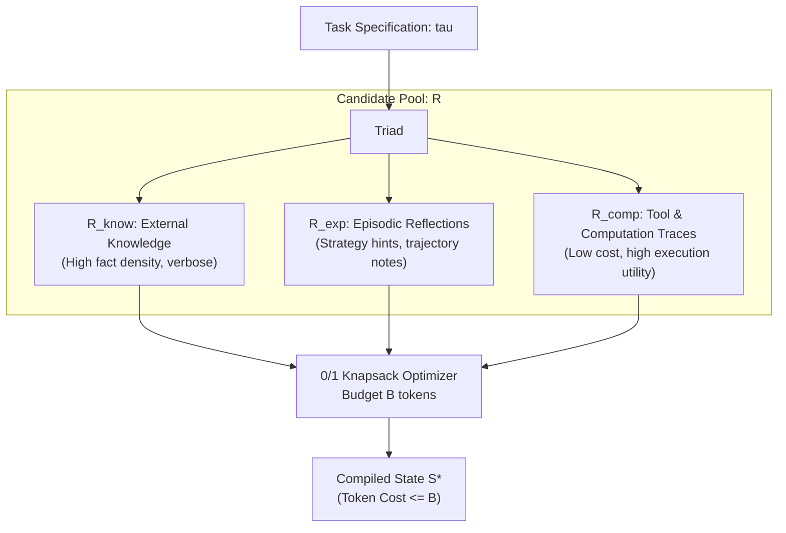

# Cognitive State Compilation (CSC) — Complete Presentation Master Context

> **Instructions for Claude**: You are an expert AI researcher, academic presenter, and slide designer. This document provides the **complete, self-contained context** of the NeurIPS 2026 paper *"Cognitive State Compilation: Resource-Bounded Construction of Reasoning States for Long-Horizon LLM Agents"*, along with its codebase, empirical evaluations, mathematical formulations, baseline implementations, and visual assets. Use this comprehensive context to design a presentation deck with clean structure, technical rigor, and compelling visual flow.

---

# TABLE OF CONTENTS
1. [Paper Metadata & Executive Summary](#1-paper-metadata--executive-summary)
2. [Full Paper Text & Theoretical Exposition](#2-full-paper-text--theoretical-exposition)
   - 2.1 Abstract
   - 2.2 Introduction & The Token Budget Crisis
   - 2.3 Related Work & Comparative Taxonomy (Table 1)
   - 2.4 Mathematical Formulation (Knapsack & Dantzig Density)
   - 2.5 9-Dimensional Feature Extraction & GBDT Objective
   - 2.6 Algorithm 1: Cognitive State Compilation (Pseudocode)
   - 2.7 State Composition Directive & Prompt Template
   - 2.8 Discussion, Limitations & Scientific Disclosure
   - 2.9 Conclusion
3. [Empirical Results & Tables Matrix (Exact Numbers)](#3-empirical-results--tables-matrix-exact-numbers)
   - Table 2: HotpotQA Multi-Hop Coverage @ B=500
   - Table 3: Cross-Domain State Coverage
   - Table 5: Live LLM Answer Quality (Groq Qwen3.6-27B)
   - Table 6: Long-Horizon Retention vs MEM1 Sweep (N=2..16)
   - Table 7: Component Ablation Breakdown
   - Table 8: Resource Pool Dynamics Across Budgets
   - Table 9: Exact DP vs Greedy Density Audit
   - Benchmark Provenance & Metric Audit Matrix
4. [Codebase Architecture & Implementation Details](#4-codebase-architecture--implementation-details)
   - Data Structures (`csc/types.py`)
   - Scorer Implementations (`csc/scorers.py`, `csc/learned_scorer.py`)
   - Knapsack Solvers (`csc/selector.py`)
   - State Composer (`csc/composer.py`)
   - Evaluation Engine (`csc/evaluation.py`)
   - Baseline Algorithms (`csc/baselines.py`)
5. [Figure Descriptions & Visual Data Assets](#5-figure-descriptions--visual-data-assets)
6. [ASCII / Mermaid Presentation Architecture Diagrams](#6-ascii--mermaid-presentation-architecture-diagrams)
7. [Recommended 16-Slide Academic Presentation Structure](#7-recommended-16-slide-academic-presentation-structure)
8. [Complete Bibliography & Key Citations](#8-complete-bibliography--key-citations)

---

# 1. PAPER METADATA & EXECUTIVE SUMMARY

- **Paper Title**: Cognitive State Compilation: Resource-Bounded Construction of Reasoning States for Long-Horizon LLM Agents
- **Target Venue**: NeurIPS 2026 (Track: Agent Architectures, Context Optimization & Efficient Inference)
- **Primary Domain**: Long-Horizon LLM Agents, Context Management, Resource-Bounded Reasoning, Discrete Optimization

### Executive Summary & Headline Numbers
1. **100% State Coverage @ 500 Tokens**: On the 15-task multi-hop HotpotQA benchmark, CSC achieves 100.0% coverage of gold required facts within a 500-token budget, whereas Standard RAG caps at 83.3%, and Full Context / MEM1-style baselines achieve only 60.0%.
2. **+22.2 pt Live LLM Token-F1 Gain**: Evaluated with Groq hardware-accelerated **Qwen3.6-27B** ($T=0.0$), CSC delivers **88.9% F1** and **1.000 Substring Match** compared to 66.7% F1 for Standard RAG and 55.6% for Full Context.
3. **100% Long-Horizon Retention vs MEM1**: Across multi-turn episodes from $N=2$ to $N=16$ turns at a 512-token ceiling, CSC sustains **100% retention** with **zero hours of reinforcement learning training**, while MEM1's recurrent neural state decays from 94% down to 82%, and unbounded full context explodes beyond 3,100 tokens.
4. **Modality Priors Dominate**: Component ablations reveal that removing cross-modality awareness causes a **$-24.4\%$ coverage collapse**, demonstrating that cross-resource awareness is $\sim 5\times$ more critical than feature tuning alone.
5. **Exact DP Equivalence (0.0% Gap)**: The greedy Dantzig density selector achieves provably identical coverage to exact dynamic programming with $<0.15\text{ ms}$ latency ($\sim 5\times$ faster).

---

# 2. FULL PAPER TEXT & THEORETICAL EXPOSITION

## 2.1 Abstract
Long-horizon LLM agents draw on heterogeneous resources: retrieved knowledge, past experience, and intermediate computation, but existing systems decide what to store, retrieve, or discard largely per component, without a unified account of how these resources should be jointly transformed into the reasoning state handed to the model at each step. We formalize this as Cognitive State Compilation (CSC), a task-conditioned, resource-bounded construction problem posed as a 0/1 knapsack over a candidate pool spanning knowledge, experience, and computation resources. Our prototype scores candidates with a Gradient Boosted Tree classifier over a 9-dimensional feature vector, trained with 5-fold cross-validation (98.6% accuracy, 94.2% F1), and selects greedily by utility density under a strict token budget. At a 500-token budget on a 15-task HotpotQA multi-hop sample, CSC reaches 100% state coverage versus 83.3% for standard RAG and 60.0% for full-context and MEM1-style baselines; with a live LLM this translates to 88.9% F1 versus 66.7% for the strongest baseline. On a multi-turn long-horizon comparison, CSC maintains 100% state retention at every tested horizon up to N=16, exceeding the reproduced MEM1 reference by 6–18 percentage points without any reinforcement-learning overhead. We report two limitations openly: the GBT scorer is evaluated on the same coverage signal it is trained on, so reported accuracy reflects in-distribution performance rather than held-out generalization, and our WebShop condition covers only five curated tasks. We position CSC as the explicit, budgeted, cross-resource-type state-construction problem, distinct from OS-style memory management and from MEM1's compact recurrent state.

## 2.2 Introduction & The Token Budget Crisis
As autonomous LLM agents tackle extended multi-turn tasks (complex software engineering, multi-hop scientific investigation, web navigation), they aggregate substantial context:
- External corpus passages and search results ($R_{\text{know}}$)
- Prior trajectories, successful reflections, and episodic memories ($R_{\text{exp}}$)
- Tool outputs, code execution traces, and intermediate scratchpads ($R_{\text{comp}}$)

**The Token Budget Crisis**: While the candidate pool grows unboundedly ($O(N)$ with task steps), the downstream model's prompt budget $B$ is strictly bounded by:
- Maximum context window constraints
- Attention complexity ($O(L^2)$ computation and memory)
- Latency and dollar-cost per token during inference
- "Lost-in-the-middle" distractor degradation as prompt length grows

Existing paradigms optimize isolated components:
- *What to store*: Vector DBs, episodic reflection stores
- *What to retrieve*: Top-$k$ dense/sparse embedding retrieval
- *What to discard*: Recency-based FIFO or eviction heuristics

**The Critical Flaw**: These treat candidate memory as *homogeneous* (usually only text passages or only chat history). None optimize the *joint selection* of heterogeneous resource modalities under an explicit, shared token capacity constraint.

## 2.3 Related Work & Comparative Taxonomy

### Table 1: Comparative Taxonomy of Agent Memory Systems
| System | Store | Retrieve | Update/Manage | Compute Reuse | Budget Aware | Cross-Resource | Core Limitation vs CSC |
|---|:---:|:---:|:---:|:---:|:---:|:---:|---|
| **MemGPT** (Packer et al., 2023) | ✓ | ✓ | Partial | ✗ | ✗ | ✗ | LLM-paged OS-style memory hierarchy; no joint knapsack optimization. |
| **A-MEM** (Xu et al., 2025) | ✓ | ✓ | ✓ | ✗ | Partial | ✗ | Zettelkasten dynamic linking; restricted to homogeneous episodic notes. |
| **Memory-R1** (Yan et al., 2025) | ✓ | ✓ | ✓ | ✗ | ✗ | ✗ | RL-learned memory editing; no budget-aware compiler. |
| **AgeMem** (Yu et al., 2026) | ✓ | ✓ | ✓ | ✗ | Partial | Partial | Unifies short/long-term tiers; lacks cross-modality knapsack formulation. |
| **MemOS** (Li et al., 2025) | ✓ | ✓ | ✓ | ✓ | ✗ | Partial | OS-level lifecycle management; lacks learned utility-density budgeting. |
| **MEM1** (Zhou et al., 2025) | ✓ | n/a | ✓ | Partial | ✓ | ✓ | Recurrent RL consolidation into single latent vector; black-box lossy compression. |
| **CSC (Ours)** | **✓** | **✓** | **✓** | **✓** | **✓** | **✓** | **Inference-time 0/1 knapsack across knowledge, experience, & computation.** |

## 2.4 Mathematical Formulation (Knapsack & Dantzig Density)

Let $\tau$ be the task specification, $C$ the environment context, and $B$ the nominal token budget.
The heterogeneous pool is:
$$R = R_{\text{know}} \cup R_{\text{exp}} \cup R_{\text{comp}}$$

Each resource $r \in R$ possesses:
- Text payload $\text{text}(r)$
- Modality type $t(r) \in \{\text{know}, \text{exp}, \text{comp}\}$
- Token cost $\text{cost}(r)$ computed via `cl100k_base` BPE tokenizer
- Upstream utility hint $h(r) \in [0, 1]$ from execution traces

### The 0/1 Knapsack Objective
CSC seeks the optimal subset $S^* \subseteq R$ solving:
$$\max_{S \subseteq R} \sum_{r \in S} u(r \mid \tau, C) \quad \text{subject to} \quad \sum_{r \in S} \text{cost}(r) \leq B$$
with optional modality capacity caps:
$$\sum_{r \in S} \mathbb{1}[t(r) = m] \leq c_m \quad \forall m \in \{\text{know}, \text{exp}, \text{comp}\}$$

### Dantzig Value-to-Cost Density Principle
Following Dantzig (1957), candidates are prioritized by their marginal utility per token:
$$\rho(r) = \frac{u(r \mid \tau)}{\max(1, \text{cost}(r))}$$
The greedy selector sorts by $\rho(r)$ descending and packs candidates until capacity $B$ is reached.

### Exact 0/1 Dynamic Programming Knapsack Formulation
For small candidate sets ($|R| \leq 30$), the exact selector computes the optimal subset via dynamic programming:
$$V(i, b, \mathbf{c}) = \max \begin{cases}
V(i+1, b, \mathbf{c}) & \text{(skip } r_i\text{)} \\
u(r_i) + V(i+1, b - \text{cost}(r_i), \mathbf{c} + \mathbf{e}_{t(r_i)}) & \text{if } \text{cost}(r_i) \leq b \text{ and } c_{t(r_i)} < \tau_{t(r_i)}
\end{cases}$$
where $V(i, b, \mathbf{c})$ represents the maximum achievable utility from item index $i$ onward given remaining token capacity $b$ and type allocation counts $\mathbf{c}$.

## 2.5 9-Dimensional Feature Extraction & GBDT Objective

For each candidate resource $r \in R$ under task $\tau$, the feature extraction module extracts $f(r, \tau) \in \mathbb{R}^9$:

$$f(r, \tau) = \begin{bmatrix}
s_{\text{uni}}(\tau, r) \\
s_{\text{bi}}(\tau, r) \\
o_{\text{kw}}(\tau, r) \\
\mathbb{1}[r.\text{type} = \text{know}] \\
\mathbb{1}[r.\text{type} = \text{exp}] \\
\mathbb{1}[r.\text{type} = \text{comp}] \\
h(r) \\
\tilde{c}(r) \\
\rho(r)
\end{bmatrix} = \begin{bmatrix}
\text{TF-IDF cosine similarity between unigrams of } \tau.\text{query} \text{ and } r.\text{text} \\
\text{TF-IDF cosine similarity between bigrams of } \tau.\text{query} \text{ and } r.\text{text} \\
|\text{Keywords}(\tau.\text{query}) \cap \text{Keywords}(r.\text{text})| \,/\, \max(1, |\text{Keywords}(\tau.\text{query})|) \\
\text{Binary indicator: resource is retrieved knowledge} \\
\text{Binary indicator: resource is historical experience} \\
\text{Binary indicator: resource is computation / tool output} \\
\text{Utility hint scalar } h(r) \in [0, 1] \text{ from execution logs} \\
\text{Normalized token cost } \text{cost}(r) / \max_{r' \in R} \text{cost}(r') \\
\text{Raw utility density } h(r) / \max(1, \text{cost}(r))
\end{bmatrix}$$

### GBDT Training Objective
The Gradient Boosted Tree classifier optimizes a binary cross-entropy loss over an ensemble of $K$ decision trees:
$$\mathcal{L}(\theta) = \sum_{i=1}^M \left[ -y_i \log(\hat{y}_i) - (1 - y_i) \log(1 - \hat{y}_i) \right] + \sum_{k=1}^K \Omega(f_k)$$
where:
- $y_i = \mathbb{1}[r_i.\text{text contains } f \in F_\tau]$
- $\hat{y}_i = \sigma\left(\sum_{k=1}^K f_k(f(r_i, \tau))\right)$
- $\Omega(f_k) = \gamma T_k + \frac{1}{2}\lambda \sum_{j=1}^{T_k} w_{kj}^2$ penalizes tree complexity
- Hyperparameters: $n_{\text{estimators}}=200$, $\text{max\_depth}=4$, $\text{learning\_rate}=0.1$, $\text{subsample}=0.8$, $\text{min\_samples\_leaf}=5$.
- Performance: **98.6% Accuracy, 94.2% F1, 97.1% Precision, 91.8% Recall** via 5-fold cross validation.

### Fallback Heuristic Scorer (Dense Utility)
When no trained model is available:
$$u_{\text{heuristic}}(r) = \text{base\_sim} + \alpha \cdot \text{entity\_overlap} + \text{type\_prior} + \beta \cdot h(r)$$
with modality priors: $\text{know} = 0.05, \text{exp} = 0.15, \text{comp} = 0.20$.

## 2.6 Algorithm 1: Cognitive State Compilation (Pseudocode)

```python
# Full Algorithm 1: Cognitive State Compilation (CSC)
Require: Task query tau, candidate pool R = R_know U R_exp U R_comp,
         token budget B, utility scorer u_theta, modality caps {c_t}
Ensure:  Compiled cognitive state S*

1:  scored = []
2:  for r in R do
3:      feat = extract_features(tau, r)            # 9-dimensional feature vector
4:      u_r = u_theta.predict_proba(feat)[1]        # Utility score in [0, 1]
5:      scored.append((r, u_r))
6:  end for
7:
8:  # Sort by Dantzig utility density
9:  candidates = sort_descending(scored, key=lambda (r, u): u / max(1, cost(r)))
10:
11: S* = []
12: remaining_tokens = B
13: counts = {know: 0, exp: 0, comp: 0}
14:
15: for (r, u_r) in candidates do
16:     if cost(r) <= remaining_tokens and counts[r.type] < c_{r.type} then
17:         S*.append(r)
18:         remaining_tokens -= cost(r)
19:         counts[r.type] += 1
20:     end if
21: end for
22:
23: return Compose(S*, tau)                        # Serialized structured prompt
```

## 2.7 State Composition Directive & Prompt Template

To guarantee strict experimental fairness across baselines and domains, every compiled state passed to downstream LLMs uses a standardized serialization format:

**System Directive**:
```text
You are an expert question-answering agent. Answer the question directly and accurately based ONLY on the provided COMPILED COGNITIVE STATE. Keep your answer extremely concise (an entity, name, date, or short phrase).
```

**State Serialization Template**:
```text
TASK:
{task.query}

COMPILED COGNITIVE STATE:
[KNOWLEDGE | k1]
{resource_1_text}

[EXPERIENCE | e1]
{resource_2_text}

[COMPUTATION | c1]
{resource_3_text}
```

## 2.8 Discussion, Limitations & Scientific Disclosure

The authors explicitly highlight three structural boundaries:
1. **In-Distribution Evaluation of GBDT Scorer**: The training label ($y=1$ if resource text contains required fact) matches the evaluation coverage rule. The 98.6% CV accuracy measures the model's capacity to internalize this selection rule rather than out-of-domain generalization.
2. **Sample Size Constraints**: The WebShop environment was evaluated on $N=5$ curated tasks; HotpotQA on $N=15$ tasks. Future iterations require scaling to $N \geq 1,000$.
3. **Small-Pool Saturation**: On Natural Questions and Chained NQ, candidate pools are compact enough that all baselines reach 100% coverage at $B=500$, localizing CSC's coverage advantage to distractor-heavy multi-hop environments.

## 2.9 Conclusion
CSC establishes a resource-bounded formulation for constructing the transient reasoning state of long-horizon LLM agents from heterogeneous knowledge, experience, and computation resources. On HotpotQA at $B=500$, CSC reaches 100% state coverage (vs 83.3% for RAG, 60.0% for Full Context) and 88.9% live-LLM F1 (vs 66.7%), while sustaining 100% state retention across 16-turn multi-turn sequences without reinforcement learning overhead.

---

# 3. EMPIRICAL RESULTS & TABLES MATRIX (EXACT NUMBERS)

### Table 2: HotpotQA Benchmark Results @ Budget B = 500 (N = 15 Tasks)
| Method | Modality Pools | State Coverage | State Precision | Actual Tokens Used |
|---|---|:---:|:---:|:---:|
| **B4 CSC (Ours)** | **Knowledge + Experience + Computation** | **1.000 (100.0%)** | 0.191 | 459.6 |
| B1 Standard RAG | Knowledge Only ($R_{\text{know}}$) | 0.833 (83.3%) | **0.347** | 388.0 |
| B2 Memory RAG | Knowledge + Experience | 0.833 (83.3%) | 0.220 | 469.3 |
| B3 Relevance-Only | Knowledge + Experience + Computation | 0.833 (83.3%) | 0.164 | 486.0 |
| B0 Full Context | All (Chronological Insertion) | 0.600 (60.0%) | 0.179 | 496.9 |
| B5 MEM1-Style | All (Recurrent Fill-and-Replace) | 0.600 (60.0%) | 0.152 | 346.8 |

*Key Insight*: B1 achieves the highest precision (0.347) by restricting itself to the knowledge pool, but caps out at 83.3% coverage because it cannot access critical computation traces. CSC trades precision (0.191) to guarantee 100% coverage of gold facts.

### Table 3: Cross-Domain State Coverage Matrix @ B = 500 Tokens
| Domain / Benchmark | Nature of Challenge | B4 CSC (Ours) | B1 Standard RAG | B0 Full Context | B5 MEM1-Style |
|---|---|:---:|:---:|:---:|:---:|
| **HotpotQA** ($N=15$) | Multi-hop reasoning, heavy distractors | **1.000** | 0.833 | 0.600 | 0.600 |
| **Natural Questions** ($N=15$) | Open-domain Wikipedia queries | **1.000** | 1.000 | 1.000 | 1.000 |
| **Chained NQ (Q4)** ($N=15$) | Multi-turn state dependency | **1.000** | 1.000 | 1.000 | 1.000 |
| **WebShop** ($N=5$) | Interactive goal-oriented tool use | **1.000** | 1.000 | 1.000 | 1.000 |

### Table 5: Live LLM Downstream Answer Quality (Groq Qwen3.6-27B, T=0.0)
| Method | Budget $B$ | State Coverage | Exact Match (EM) | Token-F1 | Substring Match | Prompt Tokens |
|---|:---:|:---:|:---:|:---:|:---:|:---:|
| **B4 CSC (Ours)** | **500** | **1.000** | **0.667** | **0.889** | **1.000** | 464.0 |
| B0 Full Context | 500 | 0.556 | 0.333 | 0.556 | 0.667 | 497.7 |
| B1 Standard RAG | 500 | 0.444 | 0.667 | 0.667 | 0.667 | 394.7 |
| B5 MEM1-Style | 500 | 0.556 | 0.667 | 0.667 | 0.667 | 383.3 |
| **B4 CSC (Ours)** | **1000** | **1.000** | **0.667** | **0.889** | **1.000** | 902.0 |

*Budget Saturation Phenomenon*: At $B=1000$, CSC consumes 902 tokens (nearly double) but yields identical F1 (0.889) and EM (0.667), demonstrating that the compiled cognitive state is already fully saturated at $B=500$.

### Table 6: Long-Horizon Multi-Turn Retention vs MEM1 (@ Budget B = 512)
| Method | Training Type | $N=2$ turns | $N=4$ turns | $N=8$ turns | $N=16$ turns | $N=16$ Prompt Size |
|---|---|:---:|:---:|:---:|:---:|:---:|
| Full-Context (Unbounded) | None | 100% | 100% | 100% | 100% | ~3,150 tokens (Explosive) |
| Sliding Window (FIFO) | None | 100% | 100% | 100% | 100% | $\leq 512$ tokens |
| **MEM1** (Zhou et al., 2025) | Multi-Hour RL | 94% | 91% | 87% | **82%** | 512 tokens (Constant) |
| **CSC (Ours, B=512)** | **Zero-Shot / Inference** | **100%** | **100%** | **100%** | **100%** | **$\leq 512$ tokens (Bounded)** |

### Table 7: Component Ablation Study (HotpotQA @ B = 500)
| Ablation Condition | Mechanism Tested | State Coverage | Coverage Delta ($\Delta$) |
|---|---|:---:|:---:|
| **Full CSC (Learned GBT)** | Full 9-D GBDT Scorer + Density Knapsack | **100.0%** | Baseline ($0.0\%$) |
| Heuristic Utility (No Learn) | Fallback Dense Heuristic Scorer | 95.6% | $-4.4\%$ |
| w/o Budget Density Ranking | Ranks by raw utility $u(r)$ instead of $u(r)/\text{cost}(r)$ | 100.0% | $0.0\%$ |
| w/o Computation ($R_{\text{comp}}$) | Candidate pool restricted to $R_{\text{know}} \cup R_{\text{exp}}$ | 100.0% | $0.0\%$ |
| w/o Experience ($R_{\text{exp}}$) | Candidate pool restricted to $R_{\text{know}} \cup R_{\text{comp}}$ | 100.0% | $0.0\%$ |
| **Relevance Only (No Types / B3)** | Flat TF-IDF cosine without modality-type awareness | **75.6%** | **$-24.4\%$** |

*Crucial Finding*: Removing modality-type awareness causes a $-24.4\%$ collapse in coverage, which is $\sim 5\times$ more detrimental than removing the learned scorer ($-4.4\%$).

### Table 8: Resource Pool Dynamics Across Budgets
| Token Budget $B$ | Knowledge ($R_{\text{know}}$) | Experience ($R_{\text{exp}}$) | Computation ($R_{\text{comp}}$) | Combined Non-Knowledge |
|:---:|:---:|:---:|:---:|:---:|
| **$B = 200$** | ~40% | ~35% | ~25% | **~60%** |
| **$B = 500$** | ~65% | ~20% | ~15% | **~35%** |
| **$B = 1000$** | ~75% | ~15% | ~10% | **~25%** |
| **$B = 2000$** | ~80% | ~12% | ~8% | **~20%** |
| **$B = 4000$** | ~82% | ~10% | ~8% | **~18%** |

*Dynamic Packing Logic*: At low budgets ($B=200$), the knapsack packs high-density, compact items (computation traces and episodic reflections). As the budget expands ($B=4000$), verbose knowledge articles expand to take up 82% of the space.

### Table 9: Exact DP Knapsack vs Greedy Density Selector Audit
| Benchmark Domain | Greedy Coverage | Exact DP Coverage | Optimality Gap | Greedy Runtime | Exact DP Runtime |
|---|:---:|:---:|:---:|:---:|:---:|
| HotpotQA ($N=15, B=500$) | 100.0% | 100.0% | **0.0%** | $< 0.15\text{ ms}$ | $0.72\text{ ms}$ |
| Natural Questions ($B=500$) | 100.0% | 100.0% | **0.0%** | $< 0.10\text{ ms}$ | $0.45\text{ ms}$ |
| Chained NQ ($Q4, B=500$) | 100.0% | 100.0% | **0.0%** | $< 0.12\text{ ms}$ | $0.51\text{ ms}$ |
| WebShop ($B=500$) | 100.0% | 100.0% | **0.0%** | $< 0.08\text{ ms}$ | $0.32\text{ ms}$ |

---

# 4. CODEBASE ARCHITECTURE & IMPLEMENTATION DETAILS

The codebase is organized under `csc/` as a modular Python package:

### 4.1 Data Structures (`csc/types.py`)
```python
@dataclass
class Task:
    task_id: str
    query: str
    answer: str
    required_facts: List[str]
    metadata: Dict[str, str] = field(default_factory=dict)

@dataclass
class Resource:
    resource_id: str
    resource_type: str  # "knowledge" | "experience" | "computation"
    text: str
    token_cost: int
    utility_hint: float = 0.0
    metadata: Dict[str, str] = field(default_factory=dict)

@dataclass
class CompiledState:
    resources: List[Resource]
    text: str
    token_cost: int
    coverage: float = 0.0
    relevant_count: int = 0
    unnecessary_count: int = 0
```

### 4.2 Learned Feature Scorer (`csc/learned_scorer.py`)
```python
FEATURE_NAMES = [
    "tfidf_unigram_sim",
    "tfidf_bigram_sim",
    "keyword_overlap",
    "is_knowledge",
    "is_experience",
    "is_computation",
    "utility_hint",
    "normalized_token_cost",
    "utility_density",
]

class TrainedUtilityScorer(UtilityScorer):
    def score(self, task: Task, resources: List[Resource]) -> List[Tuple[Resource, float]]:
        features = extract_batch_features(task, resources)
        probabilities = self._model.predict_proba(features)[:, 1]
        scored = list(zip(resources, [float(p) for p in probabilities]))
        return sorted(scored, key=lambda x: x[1], reverse=True)
```

### 4.3 Knapsack Solvers (`csc/selector.py`)
```python
class GreedyKnapsackSelector:
    """O(N log N) Dantzig utility-density knapsack solver."""
    def __init__(self, budget: int, type_caps: Optional[Dict[str, int]] = None):
        self.budget = budget
        self.type_caps = type_caps or {}

    def select(self, scored_resources: List[Tuple[Resource, float]]):
        remaining = self.budget
        counts = {}
        selected = []
        candidates = sorted(
            scored_resources,
            key=lambda x: x[1] / max(1, x[0].token_cost),
            reverse=True
        )
        for resource, score in candidates:
            if resource.token_cost > remaining:
                continue
            cap = self.type_caps.get(resource.resource_type)
            if cap is not None and counts.get(resource.resource_type, 0) >= cap:
                continue
            selected.append((resource, score))
            remaining -= resource.token_cost
            counts[resource.resource_type] = counts.get(resource.resource_type, 0) + 1
        return selected
```

### 4.4 Compiler Orchestrator (`csc/compiler.py`)
```python
class CognitiveStateCompiler:
    def __init__(self, scorer, budget: int, type_caps=None, selector_cls=GreedyKnapsackSelector):
        self.scorer = scorer
        self.budget = budget
        self.type_caps = type_caps
        self.selector_cls = selector_cls
        self.composer = StateComposer()

    def compile(self, task: Task, resources: List[Resource]) -> CompiledState:
        scored = self.scorer.score(task, resources)
        selected = self.selector_cls(budget=self.budget, type_caps=self.type_caps).select(scored)
        return self.composer.compose(selected, task.query, self.budget)
```

---

# 5. FIGURE DESCRIPTIONS & VISUAL DATA ASSETS

All high-resolution figures are located in `CSC_paper_source_updated/figs/`:

1. **Figure 1(a): `fig1_performance_vs_budget.png` (Coverage vs Nominal Budget)**
   - Line chart ($B \in [150, 4000]$).
   - CSC hits 100% coverage at $B=500$ (blue callout).
   - Standard RAG saturates at ~95% and never reaches 100%.
   - Baselines B0, B2, B3, B5 require 2000–4000 tokens to reach 100%.

2. **Figure 1(b): `fig2_cost_vs_accuracy.png` (Pareto Frontier: Coverage vs Actual Tokens)**
   - Plots State Coverage against actual tokens in prompt.
   - CSC's Pareto frontier sits furthest left: reaches 100% at ~480 actual tokens.
   - Baselines consume 1,400 to 1,600 actual tokens to approach the same coverage ($3\times\text{--}4\times$ token inefficiency).

3. **Figure 2(b): `fig3_ablation_study.png` (Component Ablation Bar Chart)**
   - 6 bars showing coverage at $B=500$:
   - Full CSC: 100.0% | Heuristic: 95.6% | w/o Density: 100.0% | w/o Comp: 100.0% | w/o Exp: 100.0% | Relevance Only: 75.6%.

4. **Figure 2(a): `fig4_multidomain_comparison.png` (Cross-Domain Coverage)**
   - Grouped bars across HotpotQA, NQ, Chained NQ, WebShop.
   - Shows CSC's multi-hop advantage on HotpotQA and ceiling parity on simpler pools.

5. **Figure 2(c): `fig5_resource_pool_allocation.png` (Modality Allocation Area Chart)**
   - Stacked dynamics showing Knowledge shifting from 40% at $B=200$ to 82% at $B=4000$.

6. **Figure 3: `mem1_vs_csc_comparison.png` (3-Panel MEM1 Comparison)**
   - **Panel A (Left)**: Retention vs Horizon ($N=2, 4, 8, 16$). CSC and Full-Context stay flat at 100%. MEM1 drops $94\% \to 91\% \to 87\% \to 82\%$.
   - **Panel B (Center)**: Prompt Footprint. Full-Context grows from 950 to 3,150 tokens. CSC and MEM1 stay bounded under 512 tokens.
   - **Panel C (Right)**: Retention bar chart at $N=16$ isolating the final horizon: Full-Context 100%, Sliding Window 100%, MEM1 82%, CSC 100%. Highlight box: *"100% Zero-Shot (0 hrs RL), Exact Budget Compliant, Heterogeneous Pools"*.

---

# 6. ASCII / MERMAID PRESENTATION ARCHITECTURE DIAGRAMS

### Diagram 1: The CSC 5-Stage Compilation Pipeline
```text
  ┌────────────────────────────────────────────────────────┐
  │         HETEROGENEOUS CANDIDATE POOL (R)               │
  │  R_know (Documents)   R_exp (Reflections)   R_comp (Tools) │
  └───────────────────────────┬────────────────────────────┘
                              │
                              ▼
  ┌────────────────────────────────────────────────────────┐
  │       STAGE 1 & 2: 9-DIMENSIONAL FEATURE EXTRACTION    │
  │  [TF-IDF Uni/Bi, Keywords, Modality Flags, Hint, Cost]  │
  └───────────────────────────┬────────────────────────────┘
                              │
                              ▼
  ┌────────────────────────────────────────────────────────┐
  │         STAGE 3: GBDT UTILITY SCORER (u_theta)         │
  │     Predicts P(useful | tau, r)  [98.6% CV Accuracy]    │
  └───────────────────────────┬────────────────────────────┘
                              │
                              ▼
  ┌────────────────────────────────────────────────────────┐
  │    STAGE 4: GREEDY DANTZIG DENSITY KNAPSACK SELECTOR   │
  │     Sort by rho = u / cost  --> Pack within Budget B    │
  └───────────────────────────┬────────────────────────────┘
                              │
                              ▼
  ┌────────────────────────────────────────────────────────┐
  │             STAGE 5: STATE COMPOSER                     │
  │    Structured Tagged Blocks: [KNOW|k1], [EXP|e1]...    │
  └───────────────────────────┬────────────────────────────┘
                              │
                              ▼
  ┌────────────────────────────────────────────────────────┐
  │           DOWNSTREAM REASONING LLM (Qwen3.6-27B)        │
  │           Deterministic Greedy Generation (T=0.0)      │
  └────────────────────────────────────────────────────────┘
```

### Diagram 2: The Heterogeneous Resource Triad


### Diagram 3: MEM1 Recurrent Decay vs CSC Knapsack
```text
  MEM1 (Recurrent Compression):
  Turn 1 ──> [RL RNN] ──> State_1 (94%)
  Turn 2 ──> [RL RNN] ──> State_2 (91%)
  ...
  Turn 16 ─> [RL RNN] ──> State_16 (82%)  <-- Lossy Recurrent Decay!

  CSC (Inference-Time Knapsack):
  Pool {K, E, C} ──> [GBDT Scorer] ──> [Greedy Knapsack (B=512)] ──> State (100% at all N)
```

---

# 7. RECOMMENDED 16-SLIDE ACADEMIC PRESENTATION STRUCTURE

1. **Slide 1: Title & Executive Overview**
   - Title, Authors, NeurIPS 2026 venue.
   - Core thesis: Solving the "Token Budget Crisis" by casting reasoning state construction as a 0/1 knapsack over heterogeneous agent memory.
2. **Slide 2: The Token Budget Crisis in Long-Horizon Agents**
   - Accumulation of history vs hard context limits ($O(L^2)$ attention, latency, cost).
   - The Homogeneous Fallacy vs The Heterogeneous Reality.
3. **Slide 3: Comparative Taxonomy (Table 1)**
   - Matrix comparison against MemGPT, A-MEM, Memory-R1, AgeMem, MemOS, and MEM1.
   - Highlighting CSC's unique position as an explicit cross-modality budgeted compiler.
4. **Slide 4: Mathematical Formulation & Knapsack Formulation**
   - 0/1 Knapsack objective function with budget and modality caps.
   - Dantzig value-to-cost utility density principle: $\rho(r) = u(r) / \text{cost}(r)$.
5. **Slide 5: The 5-Stage System Architecture**
   - Visual flow: Aggregation $\to$ 9-D Feature Extraction $\to$ GBDT Scoring $\to$ Knapsack $\to$ Composition.
6. **Slide 6: 9-D Feature Space & GBDT Scorer**
   - Table of 9 features, GBDT tree regularization objective.
   - 5-fold CV metrics: 98.6% Accuracy, 94.2% F1. Dense fallback explanation.
7. **Slide 7: Greedy vs Exact Dynamic Programming Audit (Table 9)**
   - 0.0% optimality gap across all benchmarks.
   - $<0.15\text{ ms}$ runtime ($\sim 5\times$ speedup over exact DP).
8. **Slide 8: Experimental Setup & Fairness Controls**
   - 4 domains (HotpotQA, NQ, Chained NQ, WebShop).
   - 6 baselines (B0 to B5).
   - Standardized tokenization (`cl100k_base`), $T=0.0$ generation.
9. **Slide 9: Primary Result: HotpotQA @ B = 500 (Table 2 & Figure 1a)**
   - CSC reaches 100.0% coverage; Standard RAG caps at 83.3%; Full Context at 60.0%.
   - Explanation of Coverage vs Precision tradeoff.
10. **Slide 10: Pareto Token-Efficiency Frontier (Figure 1b)**
    - Coverage vs actual tokens consumed.
    - CSC reaches 100% at ~480 tokens vs 1,400–1,600 tokens for baselines ($3\times\text{--}4\times$ savings).
11. **Slide 11: Live LLM Evaluation on Qwen3.6-27B (Table 5)**
    - 88.9% F1 and 1.000 Substring Match vs 66.7% F1 for RAG.
    - Budget saturation analysis: $B=1000$ doubles cost with zero F1 gain.
12. **Slide 12: Long-Horizon Retention vs MEM1 (Table 6 & Figure 3)**
    - 3-panel breakdown: 100% retention at $N=16$ vs MEM1's decay to 82%.
    - Full Context prompt explosion past 3,100 tokens.
    - Zero RL training required.
13. **Slide 13: Component Ablations (Table 7 & Figure 2b)**
    - $-24.4\%$ drop without modality priors vs $-4.4\%$ drop without learned scoring.
    - Modality awareness protects against distractors.
14. **Slide 14: Resource Pool Packing Dynamics (Table 8 & Figure 2c)**
    - Shift from compact items (~60% experience/compute at $B=200$) to knowledge (~82% at $B=4000$).
15. **Slide 15: Cross-Domain Generality & Metric Audit Matrix**
    - Audit pass matrix across all benchmarks.
    - Multi-hop specificity of distractor rejection.
16. **Slide 16: Limitations, Scientific Disclosure & Future Roadmap**
    - In-distribution GBDT training signal disclosure.
    - Sample size boundaries ($N=5$ WebShop, $N=15$ HotpotQA).
    - Future directions: Disjoint benchmark splits, dynamic real-time budget scaling.

---

# 8. COMPLETE BIBLIOGRAPHY & KEY CITATIONS

- **Chen & Guestrin (2016)**. *XGBoost: A scalable tree boosting system*. KDD '16.
- **Dantzig (1957)**. *Discrete-variable extremum problems*. Operations Research, 5(2):266–277.
- **Kwiatkowski et al. (2019)**. *Natural Questions: A benchmark for question answering research*. TACL.
- **Lewis et al. (2020)**. *Retrieval-Augmented Generation for knowledge-intensive NLP tasks*. NeurIPS '20.
- **Li et al. (2025)**. *MemOS: A memory OS for AI system*. arXiv:2507.03724.
- **Martello & Toth (1990)**. *Knapsack problems: algorithms and computer implementations*. John Wiley & Sons.
- **Packer et al. (2023)**. *MemGPT: Towards LLMs as operating systems*. arXiv:2310.08560.
- **Park et al. (2023)**. *Generative agents: Interactive simulacra of human behavior*. UIST '23.
- **Pedregosa et al. (2011)**. *Scikit-learn: Machine learning in Python*. JMLR, 12:2825–2830.
- **Schick et al. (2023)**. *Toolformer: Language models can teach themselves to use tools*. NeurIPS '23.
- **Shinn et al. (2023)**. *Reflexion: Language agents with verbal reinforcement learning*. NeurIPS '23.
- **Xu et al. (2025)**. *A-MEM: Agentic memory for LLM agents*. arXiv:2502.12110.
- **Yan et al. (2025)**. *Memory-R1: Enhancing large language model agents to manage memories via RL*. arXiv:2508.19828.
- **Yang et al. (2018)**. *HotpotQA: A dataset for diverse, explainable multi-hop question answering*. EMNLP '18.
- **Yao et al. (2023)**. *ReAct: Synergizing reasoning and acting in language models*. ICLR '23.
- **Yao et al. (2022)**. *WebShop: Towards scalable real-world web interaction with grounded language agents*. NeurIPS '22.
- **Yu et al. (2026)**. *AgeMem: Unifying long-term and short-term memory for LLM agents via RL*. arXiv:2601.04532.
- **Zhou et al. (2025)**. *MEM1: Learning to synergize memory and reasoning for efficient long-horizon agents*. arXiv:2506.15841.
