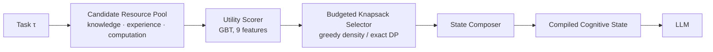
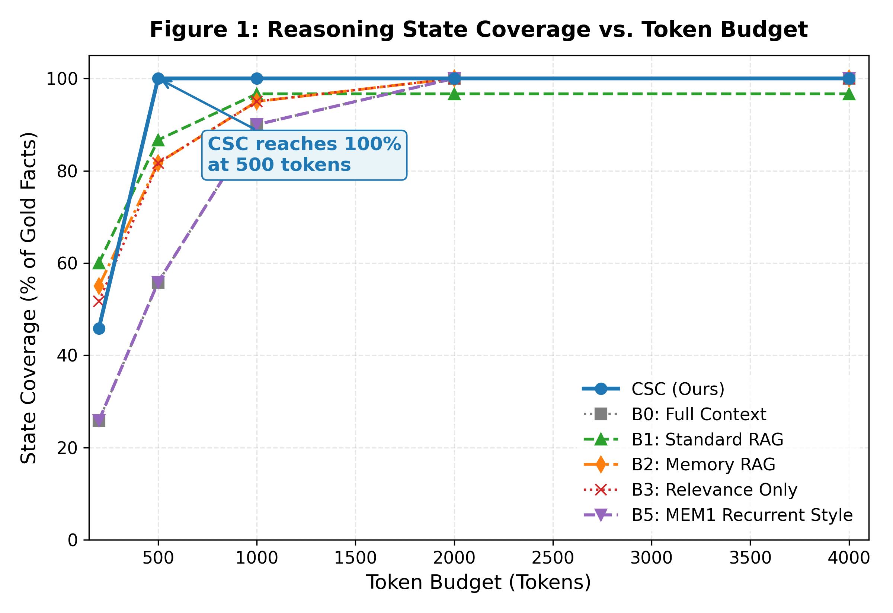
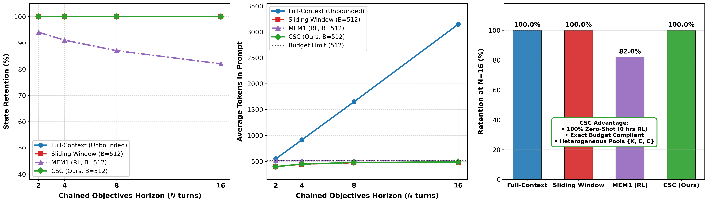

# Cognitive State Compilation (CSC)

**Resource-Bounded Construction of Reasoning States for Long-Horizon LLM Agents**

[](https://www.python.org/)
[](LICENSE)
[](#citation)

Official code release for the paper *Cognitive State Compilation: Resource-Bounded Construction of Reasoning States for Long-Horizon LLM Agents* (Workshop on Resource-Aware Agentic AI, NeurIPS 2026).

Vansh Kumar Singh\*, Keshav Jain\*, Rishi Ashish Shah, Shivaay Dhondiyal &nbsp;&nbsp;(\*equal contribution)

---

## Overview

Long-horizon LLM agents draw on three kinds of resources: **retrieved knowledge**, **past experience**, and **intermediate computation** (tool outputs, scratchpads, cached results). Existing systems usually decide what to store, retrieve, or discard one component at a time. CSC instead treats the reasoning state handed to the model at each step as something to be *compiled* under a strict token budget.

Given a task $\tau$, a heterogeneous candidate pool $R = R_{\text{know}} \cup R_{\text{exp}} \cup R_{\text{comp}}$, and a budget $B$, CSC solves a 0/1 knapsack:

$$
\max_{S \subseteq R} \sum_{r \in S} u(r \mid \tau) \quad \text{s.t.} \quad \sum_{r \in S} \text{cost}(r) \le B
$$

- **Utility $u(r \mid \tau)$** comes from a Gradient Boosted Tree classifier over a 9-dimensional feature vector (TF-IDF unigram and bigram similarity, keyword overlap, resource-type indicators, utility hint, normalized cost, utility density). A hand-specified dense scorer is used as a fallback when no trained model is available.
- **Cost** is the exact token count under `cl100k_base` (`tiktoken`).
- **Selection** is greedy by utility density, $u(r \mid \tau)/\text{cost}(r)$, with an exact dynamic-programming selector available for small pools.



## Key Results

All numbers are from the paper (15-task samples unless noted).

| Setting | CSC (ours) | Strongest baseline |
| :--- | :---: | :---: |
| HotpotQA state coverage @ B = 500 | **100.0%** | 83.3% (Standard RAG) |
| HotpotQA live-LLM F1 @ B = 500 (Qwen3.6-27B, T = 0) | **88.9%** | 66.7% |
| Long-horizon state retention, N = 16 turns, B = 512 | **100%** | 82% (reproduced MEM1) |
| GBT scorer, 5-fold CV | 98.6% accuracy / 94.2% F1 | — |

<details>
<summary><b>Full HotpotQA comparison @ B = 500</b></summary>

| Method | Coverage | Precision | Tokens Used |
| :--- | :---: | :---: | :---: |
| **B4 CSC (ours)** | **1.000** | 0.191 | 459.6 |
| B1 Standard RAG | 0.833 | **0.347** | 388.0 |
| B2 Memory RAG | 0.833 | 0.220 | 469.3 |
| B3 Relevance-Only | 0.833 | 0.164 | 486.0 |
| B0 Full Context | 0.600 | 0.179 | 496.9 |
| B5 MEM1-style | 0.600 | 0.152 | 346.8 |

</details>

<details>
<summary><b>Component ablation on HotpotQA @ B = 500</b></summary>

| Ablation | State Coverage | Δ |
| :--- | :---: | :---: |
| **Full CSC (learned GBT)** | **100.0%** | — |
| Heuristic utility (no learning) | 95.6% | −4.4 |
| w/o budget density | 100.0% | 0.0 |
| w/o computation pool | 100.0% | 0.0 |
| w/o experience pool | 100.0% | 0.0 |
| Relevance only (no types) | 75.6% | −24.4 |

</details>

<p align="center">
  
  
</p>

## Repository Structure

```
CognitiveOS/
├── csc/                         # Core library
│   ├── types.py                 # Task, Resource and CompiledState types
│   ├── tokenizer.py             # tiktoken (cl100k_base) cost model
│   ├── scorers.py               # Dense heuristic fallback scorer
│   ├── learned_scorer.py        # 9-feature GBT utility scorer
│   ├── selector.py              # Greedy density and exact DP knapsack selectors
│   ├── composer.py              # Compiled-state serialization template
│   ├── compiler.py              # CognitiveStateCompiler (scorer → selector → composer)
│   ├── baselines.py             # B0–B3, B5 comparison methods
│   ├── dataset.py               # Benchmark loaders
│   ├── evaluation.py            # Coverage, precision and cost metrics
│   └── llm.py                   # OpenAI-compatible client with retries
├── scripts/                     # Experiment runners, data preparation and plotting
├── data/                        # Prepared HotpotQA, NQ, Chained NQ and WebShop benchmarks
├── configs/default.yaml         # Budgets, resource types and metrics
├── results/                     # Figures and LaTeX tables used in the paper
├── models/                      # Trained scorer is written here (not committed)
└── tests/                       # Unit tests
```

## Installation

```bash
git clone https://github.com/Vansh-456/CognitiveOS.git
cd CognitiveOS

python -m venv .venv
# Windows: .venv\Scripts\activate
# Linux/macOS: source .venv/bin/activate
pip install -r requirements.txt
```

Everything except the live LLM evaluation runs offline on CPU with no API key.

## Quick Start

```bash
python scripts/train_scorer.py                        # train the GBT scorer (fixed seed)
python scripts/run_demo.py --benchmark hotpotqa       # compare CSC against all baselines
pytest -q                                             # run the test suite
```

## Reproducing the Paper

Run all commands from the repository root. Train the scorer first; it is not distributed as a binary but is retrained deterministically (`random_state=42` for both the classifier and the 5-fold split).

| Paper result | Command | Output |
| :--- | :--- | :--- |
| GBT scorer, 5-fold CV | `python scripts/train_scorer.py` | `models/learned_scorer.joblib` |
| Budget sweep and cross-domain coverage | `python scripts/run_demo.py --benchmark all --limit 15` | `results/multidomain_*.csv`, `results/demo_*.csv` |
| Component ablation | `python scripts/run_ablations.py --limit 15` | `results/ablation_*.csv` |
| Live LLM evaluation | `python scripts/run_llm_eval.py --benchmark hotpotqa --limit 15` | `results/llm_eval_*.csv` |
| Long-horizon comparison against MEM1 | `python scripts/compare_with_mem1_literature.py` | `results/mem1_vs_csc_literature_comparison.csv` |
| Figures 1–5 | `python scripts/plot_results.py` | `results/figures/` |
| CSC vs. MEM1 figure | `python scripts/plot_mem1_comparison.py` | `results/mem1_vs_csc_comparison.png` |
| LaTeX tables | `python scripts/export_paper_tables.py` | `results/tables/` |

`run_demo.py` accepts `--benchmark` set to `hotpotqa`, `nq`, `nq_chained`, `webshop`, or `all`.

### Live LLM evaluation

The live evaluation uses any OpenAI-compatible endpoint. Copy `.env.example` to `.env` and fill in:

```bash
LLM_API_KEY=your_api_key_here
LLM_BASE_URL=https://api.groq.com/openai/v1
LLM_MODEL=your_model_id
```

The paper uses Qwen3.6-27B on Groq with greedy decoding (T = 0). Values can also be passed as flags (`--api_key`, `--base_url`, `--model`), and `--mock` runs the full pipeline offline without API calls:

```bash
python scripts/run_llm_eval.py --benchmark hotpotqa --limit 15 --mock
```

## Baselines

| ID | Method | Description |
| :--- | :--- | :--- |
| B0 | Full Context | Appends resources chronologically until the budget is exhausted |
| B1 | Standard RAG | Top-k similarity retrieval over the knowledge pool |
| B2 | Memory RAG | Retrieval over knowledge plus experience memory |
| B3 | Relevance Only | Flat TF-IDF ranking across all pools, no type priors |
| **B4** | **CSC (ours)** | Learned utility + budgeted knapsack over all three pools |
| B5 | MEM1-style | Recurrent compact-state consolidation approximation |

All methods share the same candidate pools, tasks and token budgets. See [RESEARCH_PROTOCOL.md](RESEARCH_PROTOCOL.md) for the fairness rules.

## Limitations

- **B5 is an approximation.** The MEM1-style baseline approximates recurrent compact-state consolidation at inference time. It is not a reproduction of MEM1's reinforcement-learning training procedure.
- **In-distribution scorer accuracy.** The GBT scorer is trained and evaluated on the same coverage signal, so the reported CV accuracy reflects in-distribution performance rather than held-out generalization.
- **Small samples.** Results use 15-task samples, and WebShop covers only five curated tasks. On NQ, Chained NQ and WebShop, all methods reach full coverage at B = 500; CSC's coverage advantage is specific to the distractor-heavy HotpotQA setting.
- **Recency vs. selection.** In the long-horizon benchmark, a sliding-window FIFO baseline also reaches 100% retention, so it does not yet isolate task-conditioned selection from recency.

## Citation

```bibtex
@inproceedings{singh2026csc,
  title     = {Cognitive State Compilation: Resource-Bounded Construction of Reasoning States for Long-Horizon {LLM} Agents},
  author    = {Singh, Vansh Kumar and Jain, Keshav and Shah, Rishi Ashish and Dhondiyal, Shivaay},
  booktitle = {Workshop on Resource-Aware Agentic AI, NeurIPS},
  year      = {2026}
}
```

## License

Released under the [MIT License](LICENSE).
